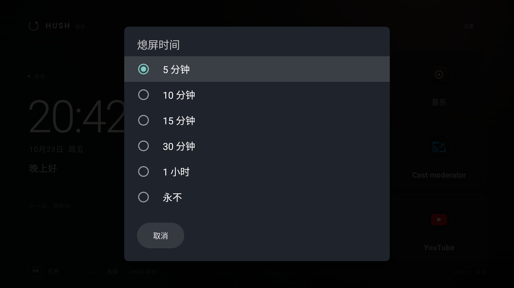
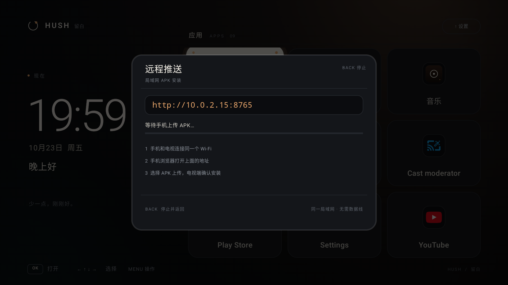

# 留白 · HUSH TV

> 少一点，刚刚好。

一个为电视遥控器设计的极简 Android TV 桌面。整个界面由一个自定义 `Canvas` 绘制，没有 AndroidX、Compose 或其它第三方运行时依赖，Release APK 约 **108 KB**。


## 效果

| 系统快捷入口 | 应用操作菜单 |
| --- | --- |
|  |  |

- 左侧是时间、日期和问候语；右侧是应用卡片。
- 应用不超过 4 个时自动变成 **2 × 2 大卡片**；5 个及以上变成 **三列网格**；超过 9 个可以纵向滚动。
- 焦点卡片使用暖白底色、轻微放大、柔光与琥珀色圆点；其余卡片保持低对比度。
- 时间按整分钟刷新，不会出现秒级跳动。

## 功能

- 读取 `LEANBACK_LAUNCHER` 与 `LAUNCHER` 应用，按组件去重；置顶应用优先，其余按中文名称排序。
- 应用图标在后台线程加载，不阻塞首帧。
- 完整方向键导航：`← ↑ ↓ →` 移动，`OK / Enter / A` 打开。
- 选中应用后按 `MENU` 打开操作菜单：**打开 / 置顶 / 信息 / 卸载**。
- 置顶应用优先展示，并在卡片左上角显示小圆点；置顶状态保存在本地，重启后仍然生效。
- 第一行按 `↑` 进入右上角「设置」，内含开发者选项、关于设备、应用管理、系统设置四个系统快捷入口，以及**远程推送**。
- 长按 `MENU`（或按 `INFO`）打开默认桌面 / Home 设置。
- 右侧设置增加「熄屏时间」：5 / 10 / 15 / 30 / 60 分钟或永不。
- 远程推送：电视开一个局域网接收页，手机/电脑浏览器上传**任意文件**；APK 自动拉起安装，其它文件保存到电视。
- 推送页会显示保存路径、已接收文件列表，支持方向键选择后 `OK` 打开、`MENU` 删除。
- 应用启动失败时自动回退到普通 Launcher intent，并给出提示。
- 注册了 `HOME` 与 `LEANBACK_LAUNCHER`，可作为电视默认桌面；带 TV banner。
- 启动器内按 `BACK` 不会退出桌面。
- 支持鼠标/触摸点击，方便在模拟器里调试。
- `minSdk 23`，`targetSdk 36`；只申请 `INTERNET`、安装未知应用等必要权限。

## 操作

- `← ↑ ↓ →`：移动焦点
- `OK / Enter / A`：打开应用
- `MENU`：打开当前应用的操作菜单
- 菜单内 `↑ ↓` 选择操作，`OK` 执行，`BACK` 关闭
- 第一行按 `↑`：进入右上角「设置」，打开系统快捷入口、熄屏时间或「远程推送」
- 推送页内：电视和手机同一 Wi-Fi，手机浏览器访问电视上显示的地址，上传文件
- 推送页内 `↑ ↓` 选择文件，`OK` 打开，`MENU` 删除并确认，`BACK` 停止服务
- 长按 `MENU` / `INFO`：默认桌面与 Home 设置（Home 被占用时查看 ADB 命令）

## 直接安装

```bash
adb install -r dist/HUSH-TV-1.6.0.apk

# 如果之前装过 v1.2.0 的预编译 APK（旧签名），需要先卸载旧包：
# adb uninstall com.hush.tv

# 把留白设为 HOME
adb shell cmd role add-role-holder android.app.role.HOME com.hush.tv

# 部分电视/模拟器自带的桌面是常驻应用，会抢在 HOME 前面。
# 如果按 Home 仍然回到原桌面，可以停用它（包名视设备而定）：
adb shell pm disable-user --user 0 com.google.android.tvlauncher

adb shell input keyevent KEYCODE_HOME
```

恢复原桌面：

```bash
adb shell pm enable com.google.android.tvlauncher
```

也可以使用脚本：

```bash
./scripts/install.sh
DISABLE_STOCK_LAUNCHER=1 ./scripts/install.sh   # 需要停用 Google TV Launcher 时
```

## 桌面没图标 / Home 键没反应？

你遇到的通常是下面三类情况。1.1 增加了普通桌面图标和设置引导：

1. **桌面没图标**
   1.0 的 Activity 只注册了 `LEANBACK_LAUNCHER` 和 `HOME`，没有普通 `LAUNCHER`。所以在手机式桌面、部分电视盒的“全部应用”里看不到它。1.1 增加了 `CATEGORY_LAUNCHER`，重新安装后应用列表里会出现「留白」。

2. **按 Home 没有弹出“选择桌面”**
   Android TV 不会因为安装了一个 HOME 应用就自动弹选择框，需要手动设置。打开「留白」后会出现设置提示，点「去设置」，在系统界面里选择「留白」并确认。之后长按 `MENU`（或按 `INFO`）可以随时重新打开默认桌面提示。短按 `MENU` 是应用操作菜单；右上角「设置」是系统快捷入口。

3. **已经选了留白，Home 还是回到原桌面**
   很多电视/盒子的原桌面是厂商常驻应用，会继续抢占 Home。用 ADB 找到它并临时停用：

   ```bash
   # 查看当前真正接管 HOME 的包名
   adb shell cmd package resolve-activity \
     -a android.intent.action.MAIN \
     -c android.intent.category.HOME

   # 以 Google TV 的 com.google.android.tvlauncher 为例
   adb shell pm disable-user --user 0 com.google.android.tvlauncher

   adb shell input keyevent KEYCODE_HOME
   ```

   留白内的「还需要停用原桌面」提示会自动显示检测到的包名，直接照着执行即可。

   

   需要恢复时：

   ```bash
   adb shell pm enable com.google.android.tvlauncher
   ```

如果执行后 Home 仍然没有反应，重启一次电视/盒子，或检查系统设置里的「默认应用 / 主屏幕」选项。部分机型不允许普通应用修改默认桌面，只能通过 ADB 停用原桌面。

## 演示应用（可选）

`screenshots/` 里的五个中文应用是预览用的独立演示 APK，不是桌面的一部分：

```bash
adb install -r dist/HUSH-TV-demo-1.0.apk
# 卸载
adb uninstall com.hush.demo
```

## 构建

要求：JDK 17+、Android SDK Platform 36、Build Tools 35.0.0。

```bash
export ANDROID_SDK_ROOT="$HOME/Library/Android/sdk"
./gradlew :app:assembleRelease
```

产物：

```text
app/build/outputs/apk/release/app-release.apk
```

仓库包含固定的 `keystore/debug.keystore`，`assembleRelease` 会使用它签名，保证每次构建和 release 的签名一致。密码和 alias 都是标准 debug 值（`android` / `androiddebugkey`），这是一份公开的侧载调试 key，不用于正式商店发布。

`local.properties` 仍然不提交。Gradle 会使用 `ANDROID_SDK_ROOT`；也可以在本地创建 `local.properties` 指定 `sdk.dir`。

## 用 Android CLI 创建 TV 虚拟机

本次验证使用 Android TV 14（API 34）arm64 镜像、1920 × 1080、320 dpi。

```bash
# 1. 安装 TV 系统镜像
sdkmanager "system-images;android-34;android-tv;arm64-v8a"

# 2. 创建一个 1080p TV AVD
echo no | avdmanager create avd \
  -n HushTV \
  -k "system-images;android-34;android-tv;arm64-v8a" \
  -d tv_1080p

# 3. 启动（Android CLI 可用时）
android emulator start HushTV

# 或者直接使用 emulator
emulator @HushTV

# 无窗口运行
android emulator start --headless HushTV
```

本仓库也提供了：

```bash
export ANDROID_SDK_ROOT="$HOME/Library/Android/sdk"
./scripts/create-tv-avd.sh
./scripts/run-tv-emulator.sh
```

启动后确认：

```bash
adb devices
adb shell wm size          # Physical size: 1920x1080
adb shell wm density       # Physical density: 320
```

> 如果在受限沙箱里启动模拟器时遇到 `TemporaryItems` / `Operation not permitted`，把 `HOME` 指到一个可写目录，或给模拟器进程对应的临时目录写权限即可。本次是在工作区内用独立的 `HOME` 完成启动的。

## 熄屏时间



右上角「设置」→「熄屏时间」，可选：

- 5 分钟
- 10 分钟
- 15 分钟
- 30 分钟
- 1 小时
- 永不

设置的是 Android 系统的 `SCREEN_OFF_TIMEOUT`，对电视全局生效，不只是留白。

首次设置需要允许「留白」修改系统设置。如果电视的设置界面没有这个入口，可以用 ADB 授权：

```bash
adb shell appops set com.hush.tv WRITE_SETTINGS allow
```

应用不再强制 `FLAG_KEEP_SCREEN_ON`，所以系统熄屏时间会真正生效；希望一直常亮就选「永不」。部分电视还有厂商自己的睡眠/节能策略，可能覆盖系统值。

## 远程推送



右上角「设置」→「远程推送」会启动一个局域网文件接收页：

1. 手机和电视连接到同一个 Wi-Fi。
2. 电视上打开「远程推送」，会显示形如 `http://192.168.1.23:8765` 的地址。
3. 手机浏览器打开这个地址，选择任意文件上传。
4. APK 会自动弹出电视安装确认；图片、视频、文档等文件会保存到电视。

电视端页面会显示：

- **保存路径**：`/storage/emulated/0/Android/data/com.hush.tv/files/Download/HUSH`
- **已接收文件列表**：名称、大小、APK 标记
- `↑ ↓` 选择文件，`OK` 打开，`MENU` 删除并二次确认
- APK 的「打开」也会走安装流程
- 其它文件用电视上的系统应用打开；没有对应应用时会提示

说明：

- 支持任意文件类型，单文件上限 300 MB；APK 会额外校验文件头。
- 页面没有访问密码，同一局域网内能打开地址的人都可以上传；离开推送页 / 按 `BACK` / App 进入后台时服务会自动停止。
- 首次使用需要允许「留白」安装未知应用；没有权限时会跳转系统设置。
- 纯局域网 HTTP，不经过云端，也不依赖 USB 或 ADB。
- 服务端口默认 `8765`，被占用时会自动换一个随机端口，以电视上显示的地址为准。
- 保存目录是应用专属外部目录，不需要存储权限；文件列表中的「删除」只删除该文件。
- 如果手机打不开地址，检查手机和电视是否在同一 Wi-Fi，以及路由器是否开启了 AP 隔离或防火墙。
- 安装完成后桌面会自动刷新应用列表。

## 系统快捷入口

右上角「设置」里的四个跳转，参考了 [ADBHelper](https://github.com/ChiKaWa3077/ADBHelper)（MIT）的四个入口：

- **开发者选项**：`Settings.ACTION_APPLICATION_DEVELOPMENT_SETTINGS`
- **关于设备**：`Settings.ACTION_DEVICE_INFO_SETTINGS`
- **应用管理**：`Settings.ACTION_APPLICATION_SETTINGS`
- **系统设置**：`Settings.ACTION_SETTINGS`

和 ADBHelper 一样，这里只负责跳转，不直接修改系统设置；USB / 网络 ADB 开关仍需要在开发者选项里手动打开。

## 项目结构

```text
hush-tv/
├── app/                         # 桌面本体
│   └── src/main/java/com/hush/tv/
│       ├── MainActivity.java     # 全屏 Activity / HOME 入口
│       ├── LauncherView.java     # 单 Canvas 桌面：绘制、焦点、动画、按键
│       ├── RemotePushServer.java # 局域网文件上传 HTTP 服务
│       ├── InstallProxyActivity.java # 前台转发系统安装确认，兼容限制后台启动的电视
│       ├── PushFileProvider.java # 把接收文件安全地交给系统应用打开
│       ├── AppRepository.java    # 后台查询应用与图标
│       └── AppEntry.java
├── demo/                        # 五个独立演示应用（影院/音乐/直播/相册/游戏）
├── screenshots/                 # 实机模拟器截图
├── dist/                        # 可安装 APK
├── scripts/                     # 安装 / 创建 AVD / 启动模拟器
└── README.md
```

## 已验证

- Android TV 14 arm64 模拟器，1920 × 1080 / 320 dpi。
- 9 个应用以三列网格展示，方向键移动焦点正常。
- `OK` 成功启动演示应用，`BACK` 返回桌面。
- `MENU` 菜单中的打开、置顶、信息、卸载入口均验证通过。
- 置顶后应用移动到首位，`force-stop` / 重启后置顶状态仍保留。
- 第一行按 `↑` 进入右上角「设置」，四个系统快捷入口都能正常拉起。
- 开发者选项、关于设备、系统设置直接进入对应页面；应用管理在部分电视上会先弹出系统组件选择器。
- 四个入口都做了异常捕获：页面不存在、被隐藏或抛出 `SecurityException` 时只提示 Toast，不会闪退。
- 已验证将熄屏时间设置为 5 分钟，系统值变为 `300000`；选「永不」时显示为 `2147483647`。
- 远程推送已完成端到端验证：局域网 HTTP 页面上传 APK → 系统安装确认 → 安装成功 → 桌面应用列表自动刷新。
- 已验证上传 PNG / TXT：保存路径显示、文件列表刷新、方向键选择、打开入口和二次确认删除均正常。
- APK 上传后优先用 `ACTION_VIEW` 直接交给系统安装器；没有处理程序时回退到前台 `InstallProxyActivity` + `PackageInstaller`，安装成功后桌面自动刷新。
- 上传 / 安装过程中按 `BACK` 或离开页面会停止接收服务。
- 按 `HOME` 进入留白；重启模拟器后仍自动进入留白。
- 卸载演示应用后，4 个系统应用自动切换为 2 × 2 大卡片布局。

## 目前的取舍

- 置顶按“最近置顶优先”排列；没有收藏分组、拖拽排序或自定义顺序。
- 不显示天气或推荐内容；除手动开启的局域网远程推送外，不访问网络。
- 远程推送保存的是应用专属目录，卸载应用会一起删除；需要长期保留请自行导出。
- 如果应用很多，需要纵向翻页；没有做首字母索引或全部应用抽屉。

这些都可以在现有 `LauncherView` / `AppRepository` 上继续扩展。
